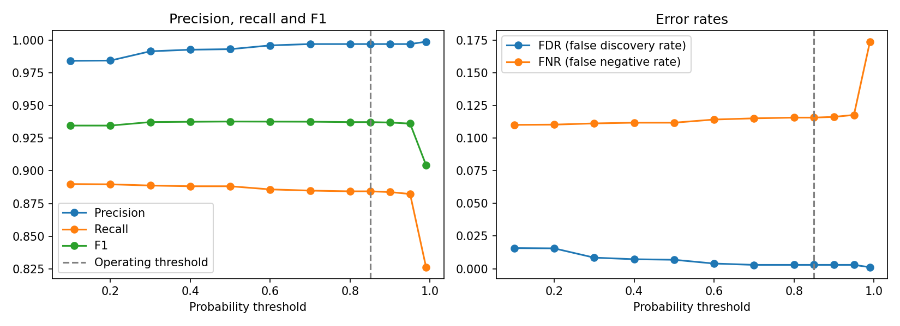

# Probabilistic Record Linkage of Hospital Discharges and a Persons Registry

Assigning a national ID (RUN) to hospital discharges that do not have one, by linking them to a
persons registry with probabilistic record linkage (Fellegi-Sunter model) in Python with
[Splink](https://moj-analytical-services.github.io/splink/).

The methodology comes from my M.Sc. thesis in Biostatistics (Universidad de Chile), where I characterized the
international migrant population in Chilean hospital data. **The thesis data are confidential and are not in
this repository.** Everything here runs on fully synthetic data that mimic the structure and the typical
problems of the real files.

## The problem

Migrant patients often appear in hospital discharge data without a valid RUN, or with a placeholder (`0`,
`99999999`, `***`). Without an identifier it is impossible to know whether two discharges belong to the same
person, or to join them with other sources. Names are written with typos, second names and surnames are
missing, birth dates are mistyped and countries are spelled in many ways, so exact matching is not enough.

## What the pipeline does

```
dat_pers.csv ───────────┐                                     ┌── validation (RUN hidden) ──> metrics, figures
dat_egr.csv  ───────────┼─> cleaning ─> common schema ─> Splink ┤
dat_egr_sin_rut.csv ────┘                                     └── discharges without RUN ──> RUN assignments
```

1. **Cleaning** (`src/cleaning.py`, `src/preprocessing.py`)
   - Splits single-field names into first name, second name and two surnames, keeping surname particles
     together (`DE LA CRUZ`, `DEL VALLE`).
   - Validates the RUN check digit and moves discharges with placeholder RUNs to the "without RUN" group.
   - Normalizes country names (accents, spelling variants), keeps foreign nationals and parses birth dates.
   - Rejects junk in name fields with rules (digits, punctuation, placeholders, single letters) instead of
     hard-coded lists.
   - Removes duplicated identities and reports identities with more than one RUN.
2. **Model** (`src/model.py`)
   - Blocking rules to avoid comparing every pair of records.
   - Jaro-Winkler comparisons for names and surnames, exact comparison for second name and country,
     and tolerance of one or two years for the birth year.
   - Parameters are **estimated from the data**: u by random sampling, m by expectation-maximisation with
     three different blocking rules (so every comparison is trained), and the prior from a deterministic rule.
     Other ways to set them are discussed under "Model parameters" below.
   - Each discharge takes the best-scoring person above a probability threshold; discharges with more than one
     candidate above the threshold are flagged as ambiguous.
3. **Evaluation** (`src/evaluation.py`): see the next section.

## How the model is evaluated

Using exact agreement on names as ground truth would be circular, because those are the same fields the model
compares. Instead:

1. Take persons and discharges that **do have a RUN**.
2. **Hide the RUN** and link them using only names, country and birth year.
3. Compare the result with the truth "same RUN = same person".

This is an independent gold standard, and the same experiment can be run on real data where RUNs are available.
Metrics are computed on pairs (precision, recall, false discovery rate, false negative rate) for several
probability thresholds, and on discharges (was the right RUN assigned?).

## Results on synthetic data (seed 42)

Validation with hidden RUN, threshold 0.85:

| Metric | Value |
|---|---|
| True pairs (same RUN) | 5,403 |
| Precision | 0.997 |
| Recall | 0.884 |
| F1 | 0.937 |
| False discovery rate | 0.003 |
| False negative rate | 0.116 |

By discharge (6,829 discharges, 5,403 of them belonging to someone in the registry):

| Outcome | Count |
|---|---|
| Correct RUN assigned | 4,775 |
| Wrong RUN assigned | 9 |
| Missed (person was in the registry, no RUN assigned) | 623 |
| Correctly left unassigned (person not in the registry) | 1,422 |

Assignment precision is 99.8% and coverage 88.4%. Raising the threshold to 0.99 removes almost all false
matches (precision 0.999) but lowers recall to 0.83, so the threshold is a trade-off between wrongly assigned
RUNs and unassigned discharges. Full tables are in `results/` and plots in `results/figures/`.

On the discharges that really lack a RUN, the model assigned a RUN to 2,791 of 3,971. Since the true RUN is
known only because the data are synthetic, `results/production_oracle_report_synthetic_only.csv` checks it:
2,788 correct and 3 wrong.



## Limitations

- **Synthetic data are easier than real data.** The injected errors (typos, missing values, swapped
  day and month, spelling variants) are simpler than real administrative data. These numbers show that the
  pipeline works, not what performance to expect on real records.
- **Compound surnames are the main weak spot.** The persons registry stores the full name in one field, and the
  splitting heuristic often misplaces the words of a compound surname. In the synthetic data, true pairs
  involving a compound surname were recovered 24% of the time, against 92% for the rest. A better parser or a
  comparison on the full surname string would help.
- Birth dates are compared by year only, because day and month are often swapped or missing. A comparison that
  tolerates swapped day and month could add information.
- Value frequency is not modelled in this demo: agreeing on a very common value (a frequent first name, or the most
  frequent country) carries the same weight as agreeing on a rare one. In the thesis analysis this was handled by
  assigning frequency-specific probabilities to very common values; Splink's term-frequency adjustments can
  automate it.
- No clerical review of uncertain pairs. Pairs between roughly 0.5 and 0.9 would normally be reviewed by hand.
- The validation uses records that have a RUN, which may be cleaner than those that do not, so it is a good
  approximation of performance on discharges without RUN, not a guarantee.

## Model parameters (m and u)

Here m and u are estimated automatically. Another valid approach is to set them from prior knowledge, for
example from descriptive statistics of the data. That can also be automated and made reproducible:

- **u** (probability of agreement between records of different people) can be computed from agreement rates
  among random pairs, which is essentially what the random-sampling estimator does.
- **m** (probability of agreement between records of the same person) can be computed from pairs with a known
  link, such as records sharing a RUN.

Whichever route is used, the values should be documented (how they were derived), and the model should be
evaluated on pairs that were not used to derive them, to avoid overly optimistic metrics. A natural next step
is to compare both configurations with the hidden-RUN validation above.

## How to run

```bash
python -m venv .venv
source .venv/bin/activate          # Windows: .venv\Scripts\activate
pip install -r requirements.txt

python run_pipeline.py             # generates the synthetic data if missing, runs everything
python run_pipeline.py --threshold 0.95   # stricter assignment
```

Tested with Python 3.12 and Splink 5.0.0.

**Migration note.** The original thesis analysis was written for Splink 4.0.8. This repository was ported to
Splink 5, the current major version. The main change is that input tables must be registered before they are
passed to the `Linker` (`db_api.register(df)`); the comparison, training and prediction calls are the same. Run
on the same synthetic data, both versions gave practically the same results (precision 0.997 and recall 0.884
at threshold 0.85).

## Repository structure

```
.
├── README.md
├── requirements.txt
├── run_pipeline.py                  # end-to-end run
├── src/
│   ├── synthetic_data.py            # generates the three synthetic tables
│   ├── cleaning.py                  # names, RUN check digit, countries, junk values
│   ├── preprocessing.py             # three tables -> common schema, deduplication
│   ├── model.py                     # Splink settings, training, prediction, RUN assignment
│   └── evaluation.py                # hidden-RUN validation, metrics, uncertainty, figures
├── data/synthetic/                  # synthetic inputs (no real people)
└── results/                         # metrics, figures and assignments from the synthetic run
```

## A note on data

`.gitignore` excludes folders and formats typically used for real data (`data/real/`, `data/raw/`, Excel,
Stata, SPSS and Parquet files). RUN-like numbers in the synthetic files are random and carry a valid check
digit, but they do not belong to real people. The column `_truth_run` exists only because the data are
synthetic and is never used to train the model.

## Author

Sebastián Campos Gómez, Biostatistician (M.Sc., Universidad de Chile).
